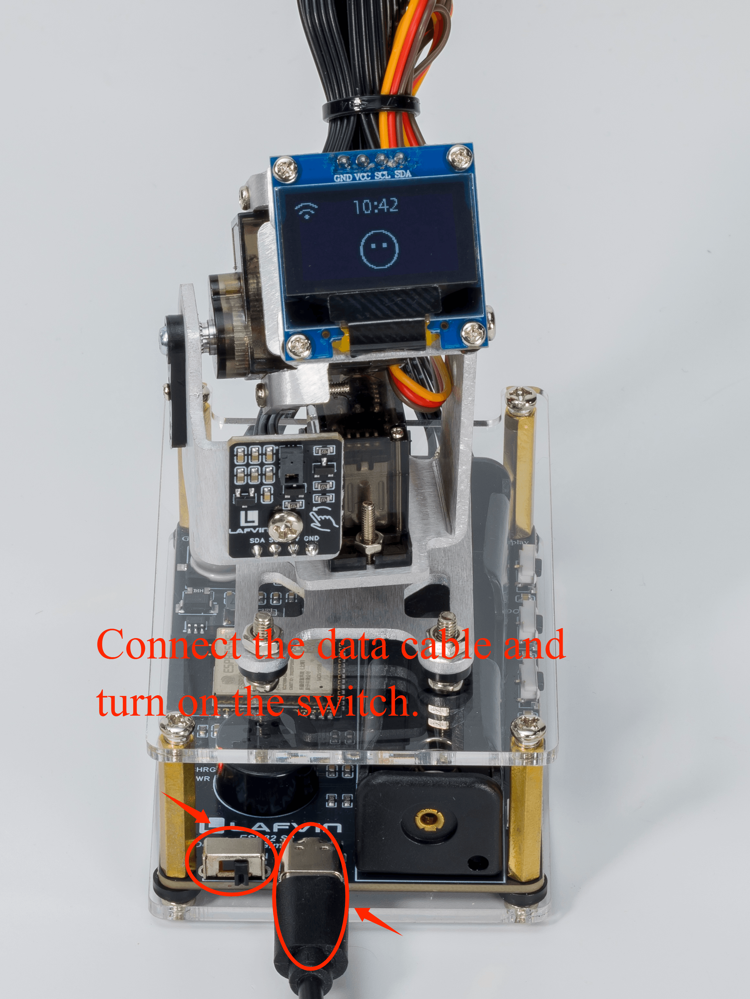
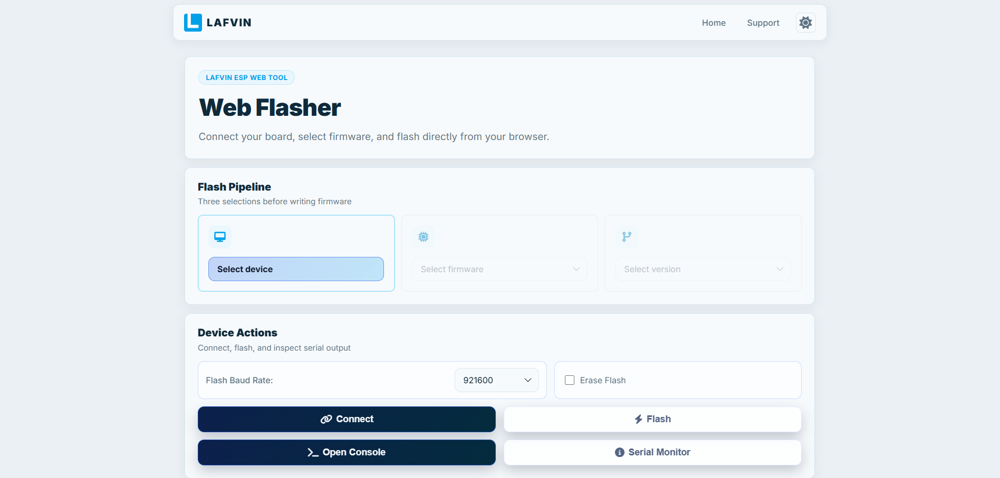
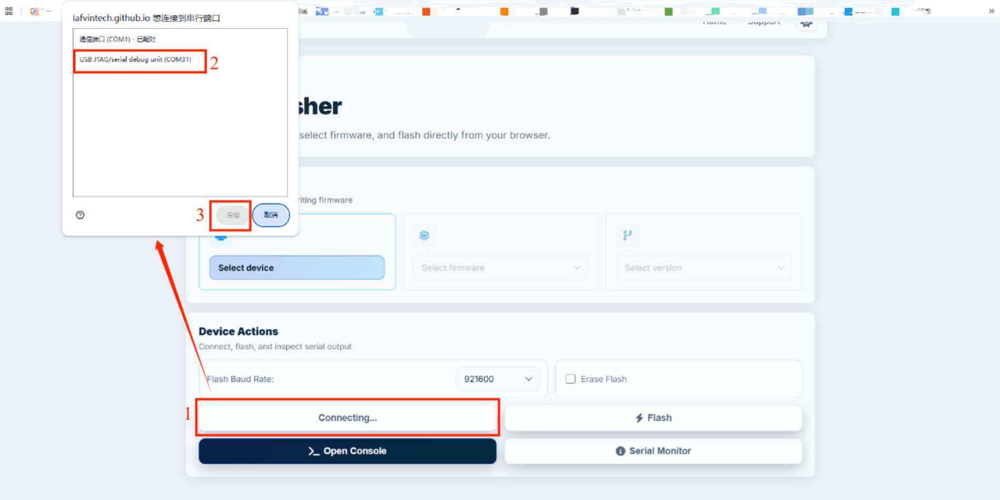
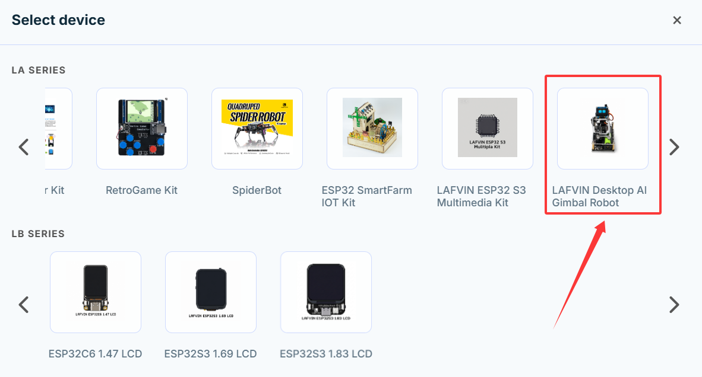
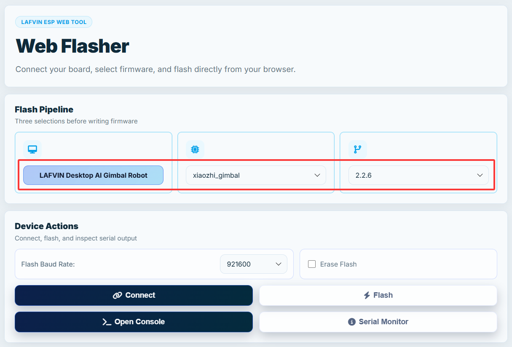
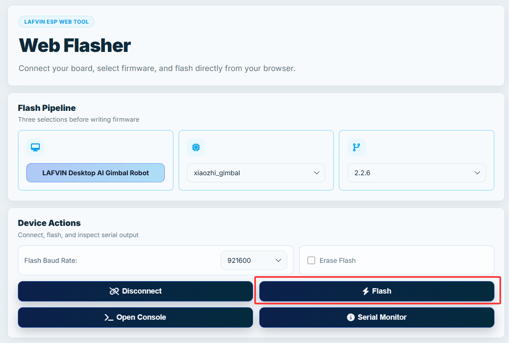
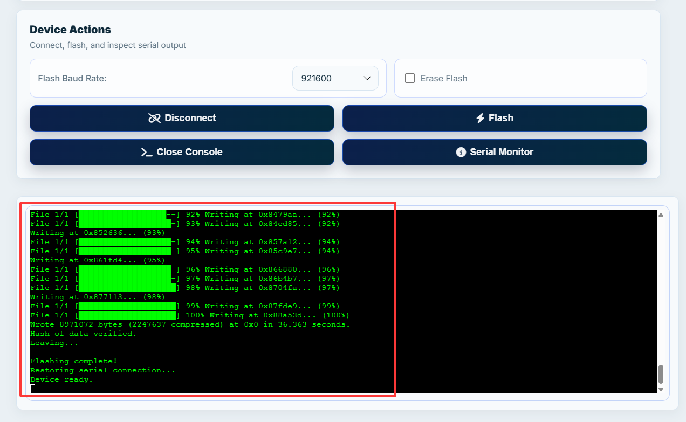
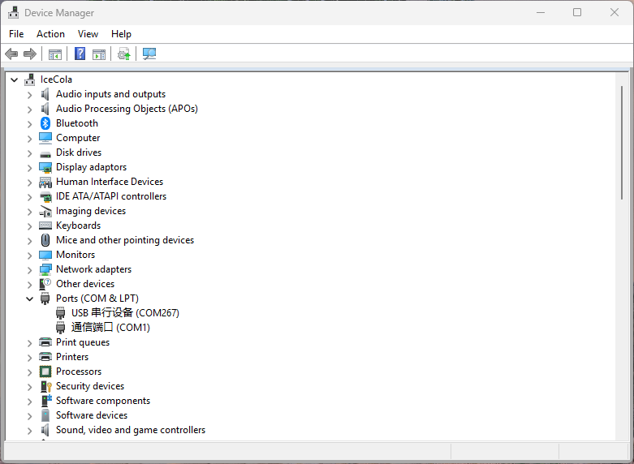
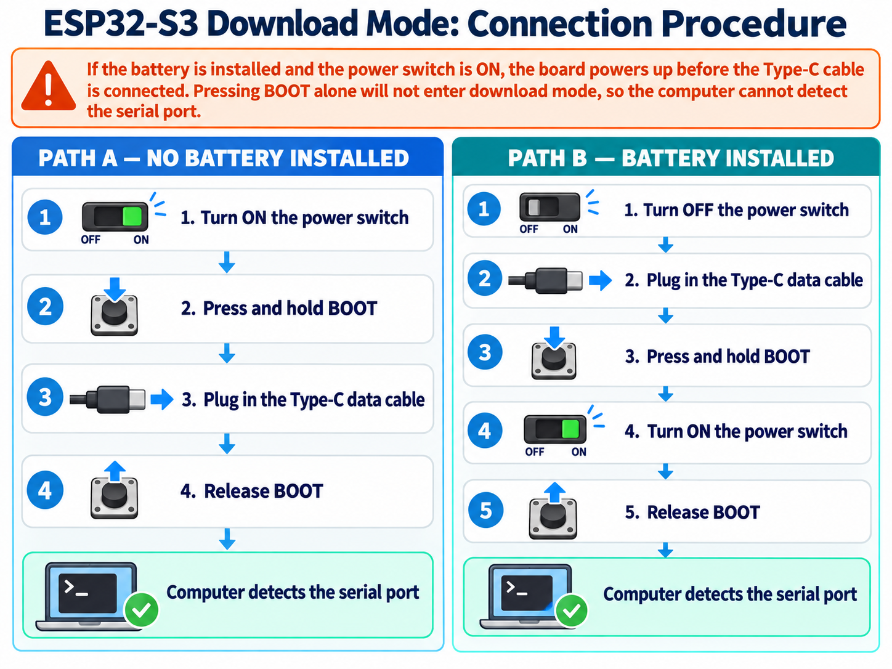

1. Flash The Firmware
=====================

**This product was not pre-programmed at the time of shipment. To use it, you will need to flash the program yourself. Please follow the instructions below to complete the flashing process.**

Online Flashing
----------------

- This method allows you to flash the program directly through the online platform without needing to install any additional software on your computer. It is a convenient option for users who prefer a straightforward flashing process.

- Please watch the video below first to learn how to flash the firmware to the main control board：

.. video:: _static/flash/flash.mp4
    :width: 100%

----

**Below is a detailed step-by-step tutorial with images.**

Step 1: Connect the Device
~~~~~~~~~~~~~~~~~~~~~~~~~~

Use the provided Type-C data cable to connect the **Desktop AI Gimbal Robot Main Control Board** to your computer.

.. raw:: html

   

.. attention::

   After inserting the data cable, you need to turn on the power switch.

----

Step 2: Access the Online Flashing Platform
~~~~~~~~~~~~~~~~~~~~~~~~~~~~~~~~~~~~~~~~~~

Click here to jump directly to the online flashing page: `LAFVIN Web Flasher <https://lafvintech.github.io/Lafvin_Web_Flasher/>`_

----

Step 3: Connect Serial Port
~~~~~~~~~~~~~~~~~~~~~~~~~~~

Click "Connect," and in the pop-up serial port selection window, select the appropriate serial port to establish the connection.

.. raw:: html

   

.. attention::

    If you are unsure which serial port to select, you can disconnect the device and check which port disappears from the list, then reconnect it and select that port.

    If a new serial port is not detected, it indicates that the main control board has not entered download mode. Please follow these steps: press and hold the **BOOT button**, connect the data cable to the main control board, and then release the **BOOT button**; the corresponding port should then be recognized.
    
    Click here to view the specific operating instructions: :ref:`Unable To Identify Port <unable-to-identify-port>`.
   
----

Step 4: Select the Firmware
~~~~~~~~~~~~~~~~~~~~~~~~~~~

Select the corresponding firmware as shown in the images below.

.. raw:: html

   

----

Step 5: Start Flashing
~~~~~~~~~~~~~~~~~~~~~~

Click the "Flash" button to start the flashing process. The progress will be displayed on the screen, and once completed, you can disconnect the device and start using it.

.. raw:: html

   

.. attention::

   The flashing process is only considered complete once the message **Flashing complete! Restoring serial connection. Device ready** appears.

----

.. _unable-to-identify-port:

Unable To Identify Port
-----------------------

- After connecting the desktop robot control board to your computer, press the "Win + X" keyboard shortcut in Windows and select "Device Manager."

- Expand the "Ports (COM & LPT)" section and check for the appearance of a new serial device. A "USB Serial Device (COMx)" or a similar entry indicates the serial port corresponding to your desktop robot control board.

.. raw:: html

   

- If no new serial port appears, or if the Device Manager window keeps refreshing or flickering, please follow the instructions for the appropriate "download mode" (based on whether or not a battery is installed) to reconnect the development board. Once done, check the Device Manager again to see if the serial port has appeared.

----

**Please follow the instructions below according to the battery configuration:**

.. raw:: html

   

A. No Battery Installed
~~~~~~~~~~~~~~~~~~~~~~~~

If no battery is installed, or the battery has been removed:

1. Turn on the power switch.
2. Press and hold the **BOOT** button.
3. Connect the Type-C data cable.
4. Release the **BOOT** button.

B. Battery Installed
~~~~~~~~~~~~~~~~~~~~~

If the battery is installed:

1. Turn off the power switch.
2. Connect the Type-C data cable.
3. Press and hold the **BOOT** button.
4. Turn on the power switch.
5. Release the **BOOT** button.

Expected Result
~~~~~~~~~~~~~~~~

After completing the steps above, the computer should recognize the
corresponding serial port of the device.

----

FAQ For Flashing Program
------------------------

If you encounter issues with flashing or the flashing process fails, please perform the following self-check steps:

1. **Check USB Connection**: Ensure the Type-C data cable is securely connected to both the Desktop AI Gimbal Robot Main Control Board and your computer. Try using a different USB port or cable if possible.

.. raw:: html

   

2. **Verify Power Supply**: Ensure that the device is properly powered on. Please insert an 18650 battery; the main control board must maintain a stable power supply throughout the flashing process.

.. raw:: html

   

3. **Check Device Drivers**: Ensure that the necessary USB drivers are installed on your computer. For Windows, check Device Manager for any unrecognized devices. For macOS/Linux, verify serial port permissions.
 
.. raw:: html

   

4. **Select Correct COM Port**: In the Flash Download Tool or online flasher, confirm that the correct COM port (serial port) is selected. You can find this in your computer's Device Manager (Windows) or System Report (macOS).
 
.. raw:: html

   

5. **Restart Software and Device**: Close the flashing software, disconnect and reconnect the device, then restart the flashing process.
 
.. raw:: html

   

6. **Disable Antivirus/Firewall**: Temporarily disable any antivirus software or firewall that might be interfering with the flashing process.

.. raw:: html

   

7. **Try Different Browser/Computer**: If using the online flasher, try a different web browser or computer to rule out compatibility issues.
 
.. raw:: html

   

8. **Check Firmware File**: Ensure you are using the correct firmware file from the provided resource package and that it is not corrupted.
 
.. raw:: html

   

If the issue persists after performing these checks, please contact our technical support team with details about your setup, error messages, and the steps you've already tried.

----
